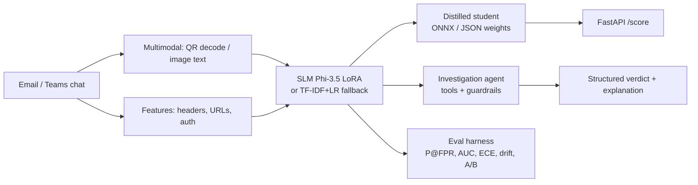

# phish-slm-guard

Research-to-production style detection of social engineering (phishing, BEC, scams, QR-code phishing / "quishing") across email and Teams-style chat, using a small language model (SLM), a multimodal path and an investigation agent — mirroring how an email-security team ships AI detections at scale.

## Architecture



## Quickstart

```bash
python3 -m venv .venv && . .venv/bin/activate
pip install -e '.[dev]'            # core is stdlib-only; tests run on laptop CPU
pytest -q && ruff check src tests scripts
python scripts/distill_and_generate.py   # synthetic corpus + distilled student
python -m phishguard.evaluate --out reports/eval_report.md
python scripts/benchmark_latency.py
pip install -e '.[sklearn,qr,serve]'     # optional heavier path
uvicorn phishguard.serve:app --port 8000 # POST /score {subject, body, sender, urls}
python scripts/train_slm.py              # dry run; --train-slm + '.[slm]' for real Phi-3.5 LoRA
```

## Results (actual run, synthetic held-out seed=99, n=280)

| Split | Precision | Recall | ROC AUC | ECE | Precision @ FPR 0.1% |
|---|---|---|---|---|---|
| Standard | 1.00 | 1.00 | 1.00 | 0.059 | 1.00 |
| Adversarial paraphrase | 1.00 | 1.00 | 1.00 | 0.061 | 1.00 |
| Time-split early / late | 1.00 / 1.00 | 1.00 / 1.00 | 1.00 / 1.00 | — | — |

Latency (fallback/student, CPU, `scripts/benchmark_latency.py`): **p50 0.31 ms, p99 0.40 ms** (n=200).
Per-family precision/recall and top FP/FN are in `reports/eval_report.md` (generated, git-ignored; regenerate above). Perfect scores reflect templated synthetic data — see Limitations.

## Design tradeoffs

- **SLM vs LLM:** Phi-3.5-mini LoRA gives rationale + family classification at far lower cost/latency than a frontier LLM per message; the distilled student serves the bulk path, SLM/agent handle grey-zone cases.
- **Distillation:** teacher verdicts → compact TF-IDF student, exported to ONNX when `skl2onnx` is available, JSON weights otherwise (portable, stdlib-loadable).
- **Calibration:** probabilities are sigmoid/logistic outputs; ECE is tracked in the harness — recalibrate (Platt/isotonic) before thresholding in production.
- **Precision @ fixed FPR:** at email scale, 0.1% FPR is still thousands of false quarantines/day, so headline metric is precision at FPR 0.1%, not accuracy.
- **Agent guardrails:** tool calls capped (`max_tool_calls`), a `malicious` verdict requires ≥2 independent evidence items, otherwise downgraded to `suspicious`.

## Limitations

Synthetic, templated corpus — real-world performance will be much lower; paraphrase split is synonym-based, not a true LLM rewrite (hook in `data.paraphrase`). Domain-age/redirect tools use mock data. ONNX Runtime / torch wheels may be unavailable on newer Pythons — the stdlib fallback keeps CI green. Not for production use without real labelled data, human review, and abuse testing.

## Layout

`src/phishguard/` — `data.py` generator+QR PNG, `model.py` SLM interface + TF-IDF/LR fallback (sklearn if present, else pure-stdlib SGD), `multimodal.py` QR decode (OpenCV/pyzbar → tEXt fallback), `agent.py` tool loop + mock LLM, `distill.py`, `serve.py` FastAPI `/score`, `evaluate.py` metrics/report/A-B bootstrap.

MIT — see `LICENSE`.
